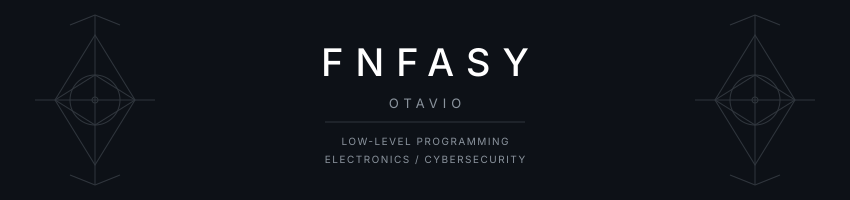

 
## About Me

Hi! I'm Otavio, an aspiring developer passionate about understanding how technology works I would like to learn low-level programming, electronics, and computer architecture. I am from Brazil and am currently a 9th-grade student, but I plan to study computer engineering in the future. 

I'm currently exploring:

- Low-level programming
- Electronics & embedded systems
- Cybersecurity
- Linux and computer systems

My goal is to deepen my knowledge, build meaningful projects, participate in CTFs and hackathons, and in the future work with cybersecurity or hardware.

I enjoy experimenting, taking things apart (and occasionally breaking something by accident), and learning something new along the way, I also enjoy writing rice recipes on Linux, and playing around with my Arduino and ESP32 and create my games.

### Technologies I am exploring

